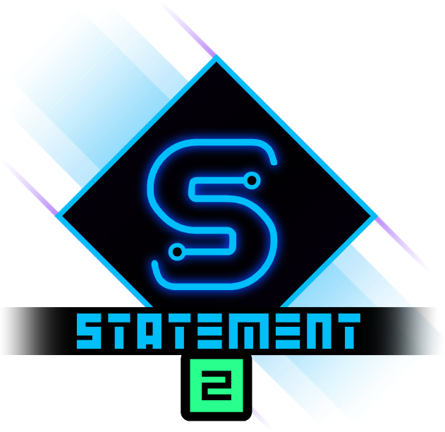
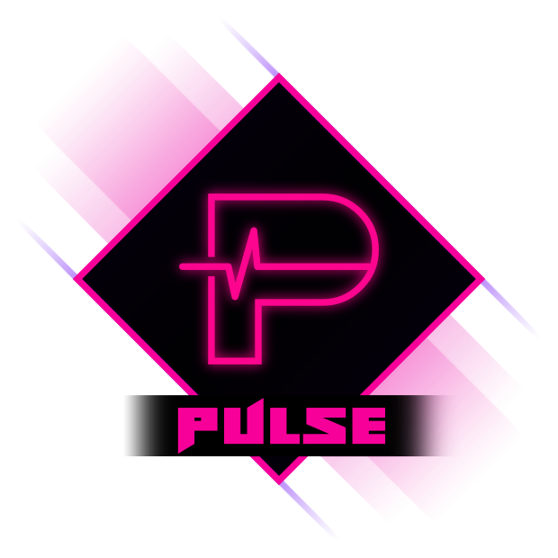
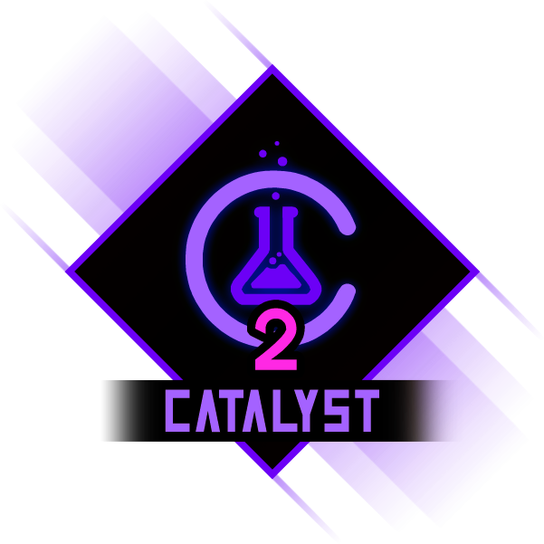
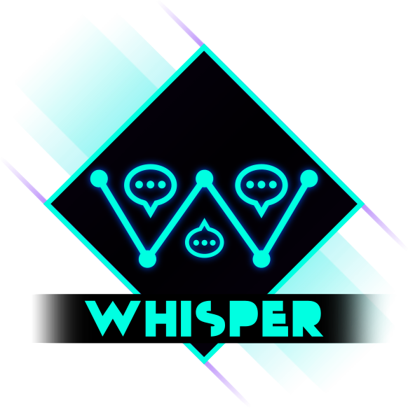
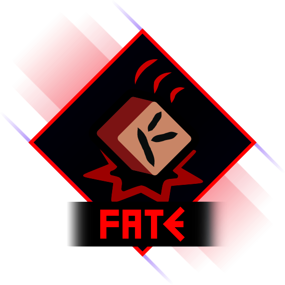
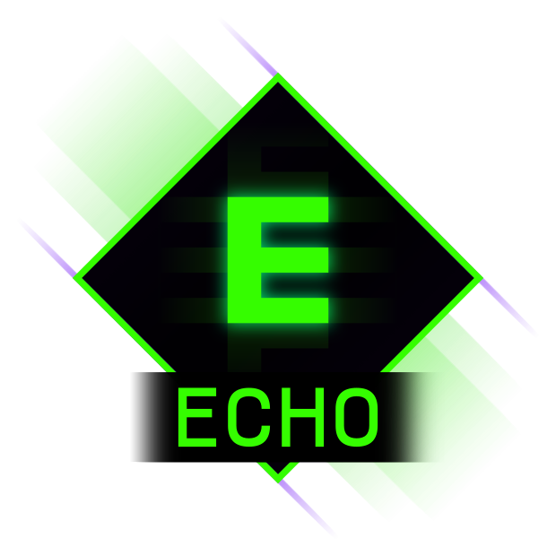

[{: style="width: 416px;" }]()
{: .text-center }
# RTG Libraries
{: .text-center}
*All you need in one bundle!*
{: .text-center}

Welcome to the hub for all documentation related to the GameMaker focused libraries created by RefresherTowel Games.

Each library is built to solve a specific pain point, with a clean API, full Feather support, and detailed docs.

---

- **Statement** decides what the game is doing.
- **Pulse** describes what just happened to anything listening.
- **Catalyst 2** makes the numbers in your game, like health, stats, buffs, fun.
- **Sundial** gives an existing 2D scene a continuous time-of-day atmosphere without turning into a full lighting engine.
- **Whisper** tells your game when it should show what dialogue, so it can feel reactive and alive.
- **Echo** tells you, in plain text, what all of the above actually did.
- **Echo Chamber** turns that debugging work into in-game consoles, inspectors, and custom development tools.
- **Quill** lets your players enter text in-game quickly and easily.
- **Fate** decides how your game plays out, with weighted random chance.

---

[{: style="max-width: 256px;"}](/statement/)
{: .text-center }
## [**STATEMENT**](/statement/)
{: .text-center }
> #### *Turn your states into a Statement!*

Sick of juggling `if` chains, tangled transitions, and forgetting where the specific `state ==` conditional you want is?

**Statement** is a clean, powerful state machine library for GameMaker that makes your game logic *not suck*. It gives each object (or struct!) its own brain, with clearly named states that handle `Enter`, `Update`, `Exit`, and optional `Draw` logic, all in one tidy place.

* **Built-in visual debugger:** Statement Lens lets you *see* your state machines live in-game...Inspect flow, watch transitions, set breakpoints, step frame by frame, even drive them manually. It’s wild.
* **Simple to start:** one machine, a few named states, one `Update()` call in Step is all you need.
* **Scales when you need it:** opt into advanced features like queued transitions, state stacks, history, transition payloads, per-state timers, and non-interruptible states.
* **Debug-friendly by design:** full API introspection, transition history, heatmaps, and logging (via the included Echo debug console).
* **Works with structs or instances**, so it plays nice with all your systems.

Use it for players, AI, UI, abilities, cutscenes. Anywhere things need to behave like... well, states.

I built out Statement for it to handle the annoying state machine boilerplate so you can simply focus on the behavior you want.

<iframe frameborder="0" src="https://itch.io/embed/4088827?linkback=true&amp;border_width=2&amp;bg_color=132f4b&amp;fg_color=ffffff&amp;link_color=007992&amp;border_color=ffffff" width="554" height="169"><a href="https://refreshertowel.itch.io/statement">Statement by RefresherTowel</a></iframe>

##### [**EXPLORE THE STATEMENT DOCS**](/statement/)
{: .text-center }

---

[{: style="max-width: 256px;"}](/pulse/)
{: .text-center }
## [**PULSE**](/pulse/)
{: .text-center }
> #### *The beating heart of your game*

Want your damage event to update the health bar, play a sound, spawn some particles, and poke the AI... without wiring a dozen fragile instance references together by hand?

**Pulse** is a signals / events layer for GameMaker that lets your game shout "something happened" and anything that cares to can listen in and react.

For small projects, it's simple and easy to use:

* Subscribe once and stop passing instance ids all over your code.
* Fire a signal and let UI, audio, VFX, and gameplay all react in their own space.
* Keep things decoupled so you can swap or remove systems without a "squash all the bugs caused by coupling" accompanying session.

For bigger, messier projects, Pulse scales up with you:

* Priorities and consumable signals so the right listener wins and can cancel the rest.
* Optional queued dispatch so you can post events now and flush them at a safe time later.
* A query API so you can ask the game a question ("who wants this target?") and collect structured answers.
* Subscription groups so entire states, rooms, or UI panels can clean up their listeners in one call.
* Multiple buses so gameplay, UI, and debug tools can each live on their own event channels.
* Safety features like weak refs, automatic pruning, and result enums so you can detect and debug weird cases instead of guessing.

If all you want is "emit event, something happens", Pulse does that in a couple of lines.
If you want your whole project to sit on a clean, debuggable event layer, Pulse is built for that too.

<iframe frameborder="0" src="https://itch.io/embed/4116520?linkback=true&amp;border_width=2&amp;bg_color=370028&amp;fg_color=ffffff&amp;border_color=ffffff" width="554" height="169"><a href="https://refreshertowel.itch.io/pulse">Pulse by RefresherTowel</a></iframe>

##### [**EXPLORE THE PULSE DOCS**](/pulse/)
{: .text-center }

---

[{: style="max-width: 256px;"}](/catalyst/)
{: .text-center }
## [**CATALYST 2**](/catalyst/)
{: .text-center }
> #### *Turn raw numbers into reactions*

Are your stats boring? Do they just sit around doing nothing? Well in that case **Catalyst 2** is the library you want!

**Catalyst 2** is a feature rich yet easy to use stats, resources and effects framework for GameMaker. It treats numbers in your game as living systems instead of isolated digits.

- Handle health, damage, stats, resistances, buffs, debuffs, item bonuses, and more in one consistent way.
- Stack and combine effects without writing a new special case every time.
- Built for weird ideas: context aware modifiers, derived stats, and complex interactions without tearing up your code.

<iframe frameborder="0" src="https://itch.io/embed/4164612?linkback=true&amp;border_width=2&amp;bg_color=450074&amp;fg_color=ffffff&amp;link_color=9080ff&amp;border_color=ffffff" width="554" height="169"><a href="https://refreshertowel.itch.io/catalyst">Catalyst 2 (GameMaker Moddable Stats) by RefresherTowel</a></iframe>

##### [**EXPLORE THE CATALYST DOCS**](/catalyst/)
{: .text-center }

---

[{: style="max-width: 256px;"}](/sundial/)
{: .text-center }
## [**SUNDIAL**](/sundial/)
{: .text-center }
> #### *A visual time-of-day colour grader for GameMaker*

Want a scene to move from morning to day, dusk, night and dawn without building a whole lighting system around it?

**Sundial** grades an existing 2D scene through a continuous day/night cycle. Author colour looks for different periods of the day, control day/night brightness separately, optionally split indoor and outdoor areas with a mask, and let Sundial handle the transitions between them.

Its native IDE plugin ([available free to try out!](https://plugins.refreshertowel.games/)) lets you import a screenshot from your own game and tune the result visually, while the runtime itself stays small and can still be configured entirely from GML.

<iframe frameborder="0" src="https://itch.io/embed/5130558?bg_color=8d4800&amp;border_width=2&amp;fg_color=ffffff&amp;link_color=faa85b&amp;border_color=ffffff" width="552" height="167"><a href="https://refreshertowel.itch.io/sundial">Sundial - Day/Night Cycle &amp; Moods by RefresherTowel</a></iframe>

##### [**EXPLORE THE SUNDIAL DOCS**](/sundial/)
{: .text-center }

---

[{: style="max-width: 256px;"}](/whisper/)
{: .text-center }
## [**WHISPER**](/whisper/)
{: .text-center }
> #### *Make your narrative scream with Whisper!*

Ever wanted to build a game that has a narrative that reacts to the players actions, like the narrative in Hades that "remembers what you did", or a storyteller-style stream of eligible events for a game like RimWorld? Or maybe trait-driven event chains and situational scenes that appear because of who your character is and what they've done like in Crusader Kings?

Then you want Whisper.

Whisper is a narrative manager built around the concept of "storylets". In essence, you add your story to Whisper, tell Whisper how you want that story managed, and then Whisper surfaces the right bit of story ("storylet") for the right moment in your game. 

<iframe frameborder="0" src="https://itch.io/embed/4234087?linkback=true&amp;border_width=2&amp;bg_color=004140&amp;fg_color=ffffff&amp;link_color=5bfae2&amp;border_color=ffffff" width="554" height="169"><a href="https://refreshertowel.itch.io/whisper">Whisper (GameMaker Narrative Director) by RefresherTowel</a></iframe>

##### [**EXPLORE THE WHISPER DOCS**](/whisper/)
{: .text-center }

---

[{: style="max-width: 256px;"}](/quill/)
{: .text-center }
## [**QUILL**](/quill/)
{: .text-center }
> #### *Let your players write with ease*

Quill is an advanced text input library, designed to let you quickly and easily create interactable textboxes for your players. Quill automatically handles all the things that people expect when they encounter a textbox, such as caret movement, selection, clipboard, undo/redo, labels, right-click context menus, validation messaging, and proper theming including both basic primitives and sprites.

<iframe frameborder="0" src="https://itch.io/embed/4281829?linkback=true&amp;border_width=2&amp;bg_color=502700&amp;fg_color=ffffff&amp;link_color=ffcb49&amp;border_color=ffffff" width="554" height="169"><a href="https://refreshertowel.itch.io/quill">Quill (GameMaker Text Boxes) by RefresherTowel</a></iframe>

##### [**EXPLORE THE QUILL DOCS**](/quill/)
{: .text-center }

---

[{: style="max-width: 256px;"}](/fate/)
{: .text-center }
## [**FATE**](/fate/)
{: .text-center }
> #### *Decide your players' Fate!*

Fate is a weighted drop library, designed to make random chance less random and more guided. Set up loot tables, give drops weighting, and then roll for a drop (or multiple drops)! It has plenty of features (including all the common gacha mechanics) to allow you to do things like guarantee particular drops, or apply pity mechanics to make sure players don't feel cheated by random bad luck, or have nested loop tables, and so on. Perfect for actual in-game drops from a chest, or even conceptually different things like deciding which enemies a player should encounter, or how your procedurally generated map picks its parts. There are many applications beyond simply dropping loot for your players!

<iframe frameborder="0" src="https://itch.io/embed/4299009?linkback=true&amp;border_width=2&amp;bg_color=460000&amp;fg_color=ffffff&amp;link_color=e80000" width="554" height="169"><a href="https://refreshertowel.itch.io/fate">Fate - Advanced Weighted Drops for GameMaker by RefresherTowel</a></iframe>

##### [**EXPLORE THE FATE DOCS**](/fate/)
{: .text-center }

---

[{: style="max-width: 256px;"}](/echo/)
{: .text-center }
## [**ECHO**](/echo/)
{: .text-center }
> #### *Hear what your game is telling you*

Plain debug logs are fine at first, but quickly become noise once your project grows.

**Echo** is a lightweight **debugging** framework for GameMaker. Your game is always talking and Echo helps you hear what it's telling you. Instead of a wall of `show_debug_message()` calls, you get structured logs, levels, history, and other features that make problems stand out.

- Log at different levels and filter what hits the console.
- Keep a debug history for the current session and dump it to file when needed.
- Optional extras like stack traces and an easy way to mute all logging with a single setting.

Echo ships free with all available frameworks and integrates cleanly with their designs. Or you can purchase it for cheap on its own.

Echo also ships with [**Echo Chamber**](/echo-chamber/), the in-game debug UI framework used to build Echo Console and custom development tools.

<iframe frameborder="0" src="https://itch.io/embed/4089088?border_width=2&amp;bg_color=1d471e&amp;fg_color=ffffff&amp;link_color=109200&amp;border_color=ffffff" width="554" height="169"><a href="https://refreshertowel.itch.io/echo">Echo by RefresherTowel</a></iframe>

##### [**EXPLORE THE ECHO DOCS**](/echo/)
{: .text-center }

##### [**EXPLORE THE ECHO CHAMBER DOCS**](/echo-chamber/)
{: .text-center }