<div class="sticky-toc" markdown="block">
<details open markdown="block">
  <summary>On this page</summary>
  {: .text-delta }

1. TOC
{:toc}

</details>
</div>

# Using the Visual Editor Plugin

You *can* configure Sundial entirely in code, but choosing how different colours will impact the moods of your game is one of those jobs where typing in RGB values and then running the game and checking is a terrible substitute for being able to dynamically watch changes happen as you make them.

That's why I built the **Sundial Visual Editor** plugin, which gives Sundial a native GameMaker editor to allow you to edit your day/night grading live. Simply import a screenshot from your game, scrub through the time of day and change the colours while looking at the actual scene as it would appear in-game.

>The Sundial Visual Editor is **completely free** to try out! Simply visit <a href="https://plugins.refreshertowel.games/" target="_blank" rel="noopener noreferrer">RefresherTowel Games Plugin Access</a> for instructions on how to download and install it, then start trying it out with your game!
{: .important}

This page will walk you through exactly how to use the Visual Editor plugin for Sundial, taking you from installing the plugin to an authored preset running in your game.


*The Sundial Visual Editor*

---

## Installing and opening Sundial

Sundial Visual Editor is installed through GameMaker's Package Manager and is available completely free for you to try out (of course, it won't make Sundial work in your game unless you have actually purchased Sundial). 

For full instructions on how to get and install plugins for my libraries into GM, please visit this page: <a href="https://plugins.refreshertowel.games/" target="_blank" rel="noopener noreferrer">RefresherTowel Games Plugin Access</a>

Quickly, the steps for a clean install are:

1. Install Sundial Visual Editor from its GMPM source.
2. Make sure that it is enabled in Package Manager (the checkbox to the left of it needs to be **checked**). *This is almost certainly the step you will forget!* Make sure you look to the left of the plugin name, and make sure to check the check box that is there.
3. Restart GameMaker **after** installing and enabling the plugin.
4. Open the project you want to author.
5. Choose **Tools > Sundial**.

Installing the package and enabling the plugin are two **completely separate** steps in GameMaker. If Sundial is installed but **Tools > Sundial** doesn't appear, check that the plugin itself is enabled and has been loaded by the IDE.

The plugin only helps you author your scene. It isn't something your game loads at runtime, and so it doesn't add any extra load times or cpu cost or anything like that, it's purely a GM editor only.

---

## Importing a screenshot

Start by importing a screenshot from your game.

> Usually you can take a screenshot by pressing `Windows key + shift + S` and selecting an area of the screen on Windows, alternatively you can usually press the `printscrn` key. The exact method can differ depending on your setup, so try out a couple of different key combinations or do some research if these don't work for you (I don't own a mac so I can't offer advice on that platform).
{: .note}

Try to pick a screenshot that contains a good representation of any distinctive features your game might have, like particularly bright colours or interesting colour combinations. If your game has bright grass, dark stones, water and a bunch of other variations like that in the same kind of scene, then that's a good screenshot to use. You're looking for a representative screenshot that makes it easy to notice when one of the grades is pushing something too far.

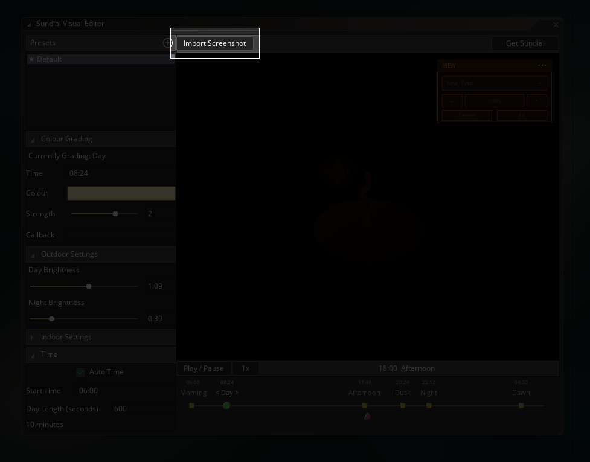
*Importing a screenshot*

After you've imported the screenshot, it should show up in the preview section.

I've tried to make it so the preview window has all the normal navigation controls you'd expect from an image editor. You can pan, zoom, fit the image, return to 100%, or centre it and that kind of thing.

---

## Times of the day

The timeline contains Sundial's six authored periods:

```text
Morning -> Day -> Afternoon -> Dusk -> Night -> Dawn -> Morning
```

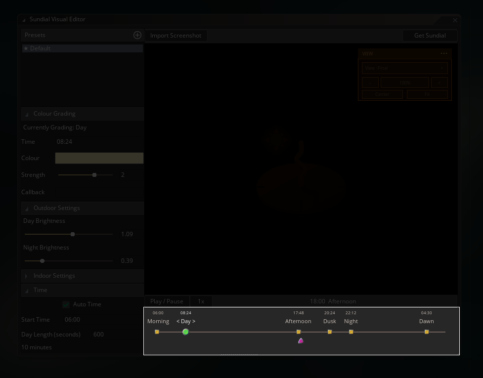
*Sundial Time Periods*

Click on one of the yellow squares to select a specific time period. The **Colour Grading** panel then edits that period's:

```text
Time
Colour
Strength
Callback
```

The selected time period shows up as a green dot on the scrubber. You can also drag them around to adjust how long the time periods last relative to one another (Morning, specifically, is fixed in place, as it is the "start" of the day cycle, but you can change what *time* Sundial treats Morning as starting using the **Time** input).

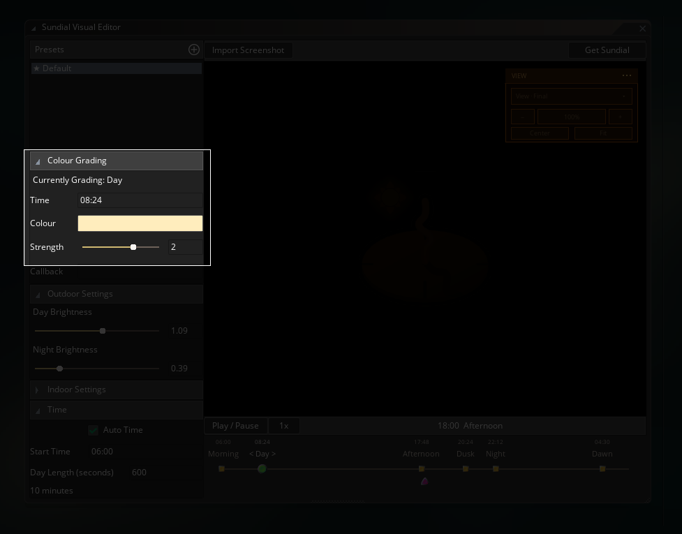
*Sundial Colour Grading*

**Colour** chooses the hue Sundial biases the scene toward.

**Strength** controls how strongly that colour affects the scene. It isn't limited to `0..1`, instead it can push values above `1` to deliberately exaggerate the colour shift when you want a much stronger stylised look.

You can scrub the separate preview playhead anywhere across the timeline to see the continuous visuals between the six time periods as they flow into each other by dragging the arrow icon under the timeline.

**Play / Pause** starts or stops automatic play through of the preview timeline, and the playback-rate control lets you cycle through the day faster.

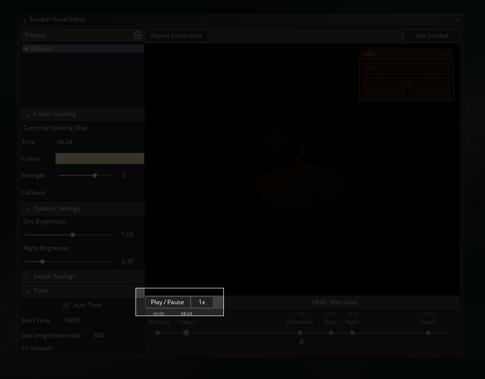
*Sundial Play Preview*

> **Play / Pause** and the speed scale **1x / 2x / etc** don't effect anything **in-game**, they are purely for the visualiser.
{: .important}

As mentioned earlier, Morning is the cycle "seam", so it stays fixed at the very start of the timeline. The other five nodes can be dragged horizontally to change what time they begin.

Typing a period's **Time** does the same job using a clock value instead. So, if you decided to enter `18:30` when Dusk is selected, that moves the Dusk node to 18:30, and Dusk will "arrive" at 18:30 in your game.

---

## Presets

The **Presets** list on the left holds different Sundial setups for your game.

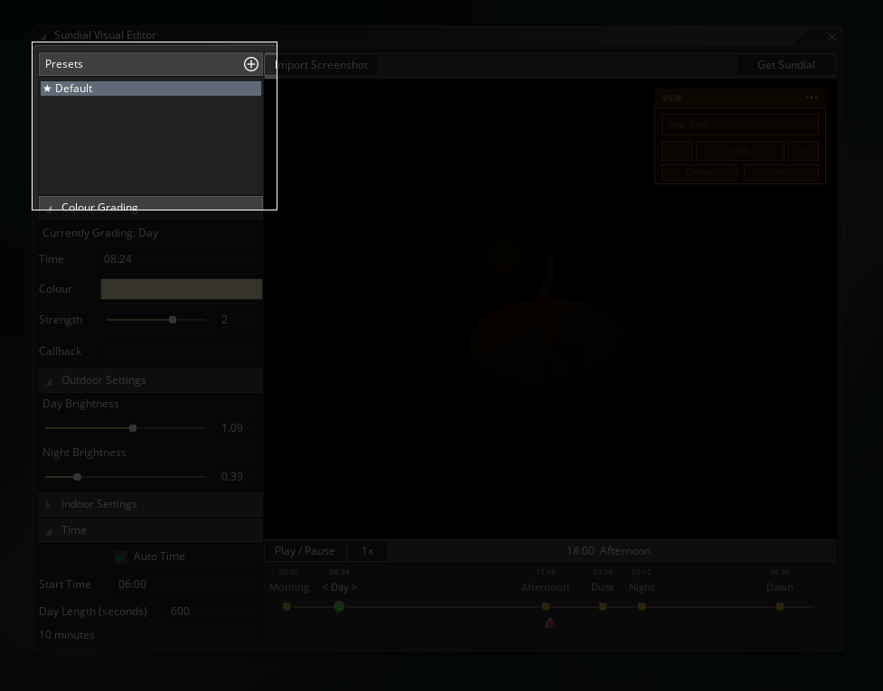
*Sundial Presets*

Use the `+` button to create a new preset from Sundial's defaults. Right-click an existing preset to see the available actions for it:

- Rename
- Duplicate
- Set as Default
- Delete

Duplicate is useful when two areas should share the same rough day/night shape but have different colour character. You can build an Overworld preset, duplicate it into Winter, then push the new one colder without rebuilding every timing from scratch.

There's always one default preset. When you start Sundial, you can choose to supply the name of one of the other presets to get that one running.

---

## Outdoor, indoor and time settings

The other foldouts apply to the whole selected preset rather than one grading anchor.

**Outdoor Settings** contains the Day and Night brightness values. Brightness is kept separate from grading colour, as making Night **blue** and making Night *dark* are two different artistic decisions, and therefore Sundial doesn't treat them as a single setting.

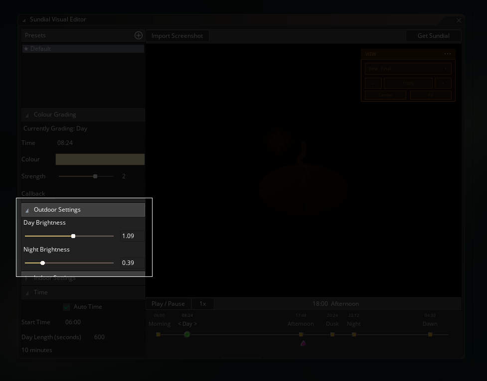
*Sundial Outdoor Settings*

**Indoor Settings** contains the indoor base colour, grading strength, daylight influence and separate Day/Night brightness values. These only become visible as effects in your game when you supply a runtime mask that marks pixels as indoor.

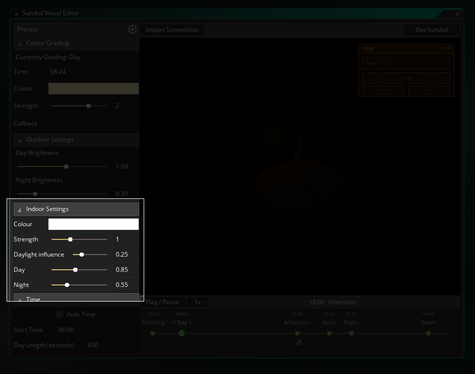
*Sundial Indoor Settings*

**Time** contains:

```text
Auto Time
Start Time
Day Length
```

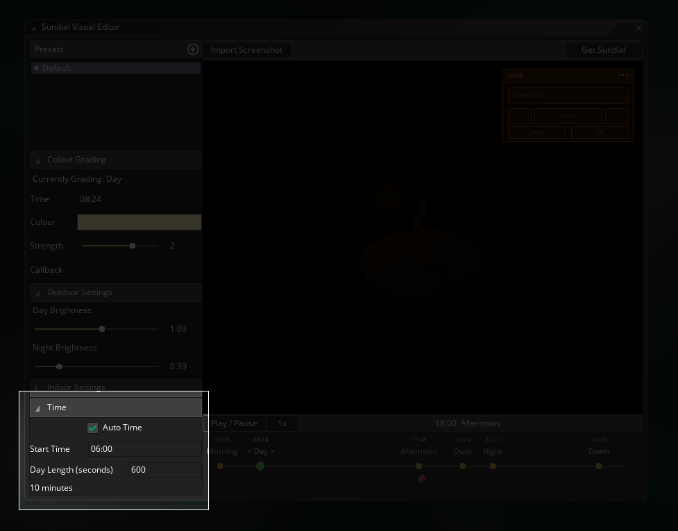
*Sundial Time Controls*

Auto Time decides whether an imported Sundial should advance its own clock. You should only turn this off if you already have a time system in your game and want to manually sync Sundial with that time. Start Time is the clock time that Sundial starts at when it begins running in your game. Day Length is how many real-world minutes a complete game day should take.

> These time settings are different to the editor's **Play / Pause** and **1x / 2x / etc** buttons. Those buttons are only for previewing. These settings are the live settings for how time works when Sundial is running in your game.
{: .note}

---

## Previewing interiors

The **Import Preview Mask** becomes available when you have added a screenshot. If your game contains indoor and outdoor areas and you want to change the indoor colour grading, you can use this to preview how a mask would look in-game.

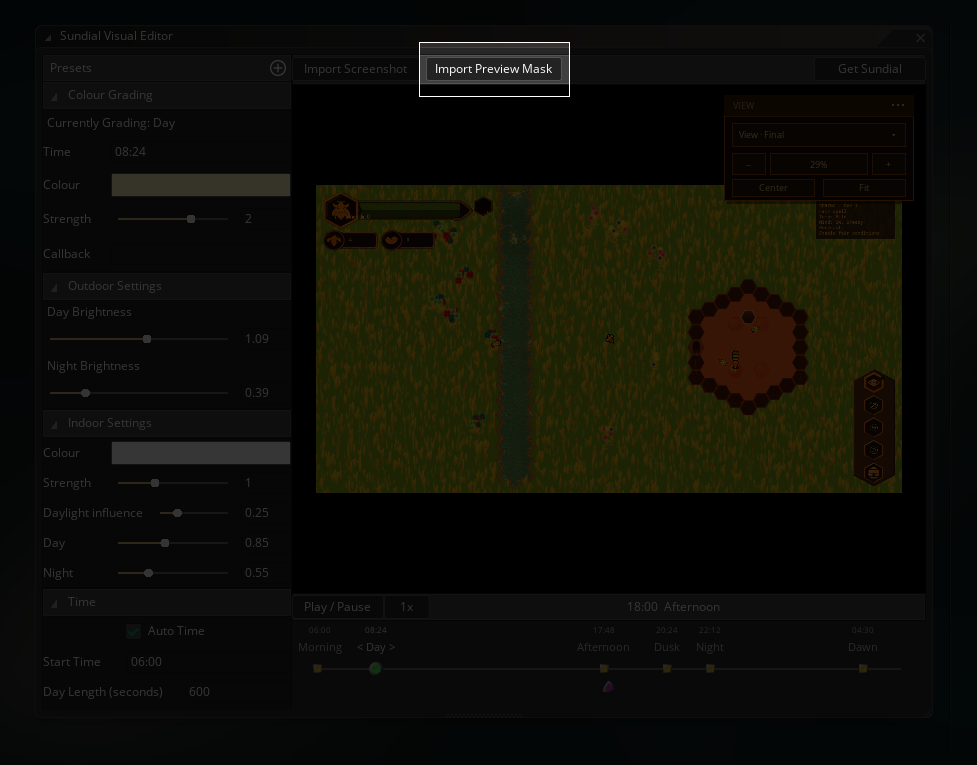
*Sundial Import Mask*

The preview mask should be drawn exactly the same as a runtime mask:

```text
black = outdoor
white = indoor
grey  = proportional blend
```

> Only the red channel actually matters, but black and white is easier to understand.
{: .note}

To show you an example of what you might want to mask, here's a screenshot from one of my WIPs, a top-down bee sim game.

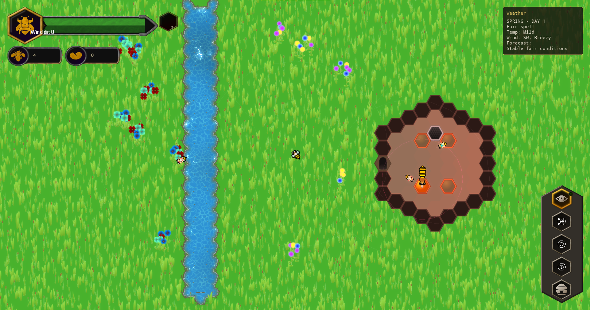
*Bee Sim Screenshot*

And here's the mask, where you can see I've essentially replaced the hive with a fuzzy white colour.


*Bee Sim mask*

And once I tweak the indoor settings, I can get a nicely lit bee hive when it's dark outside:

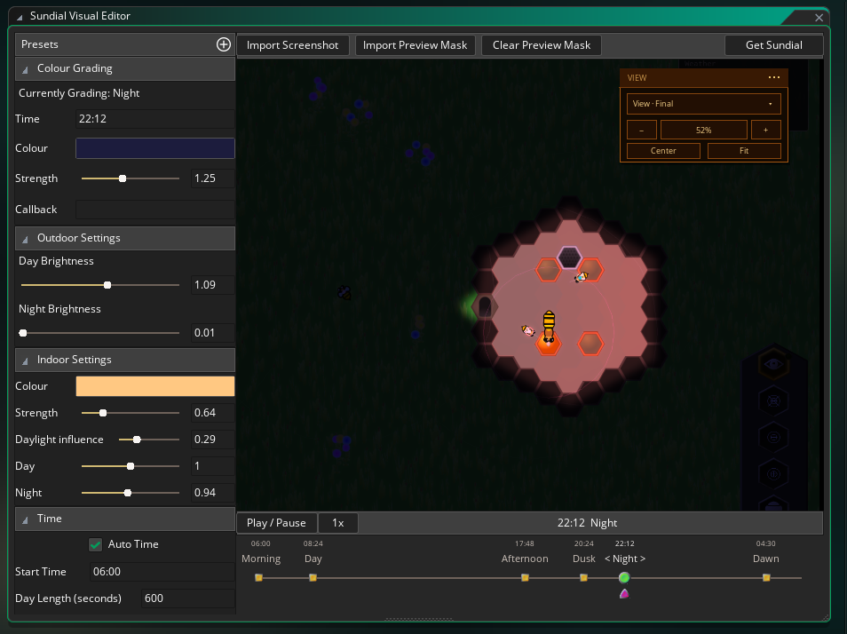
*Bee Sim night hive*

And have the hive still look normal during the day:

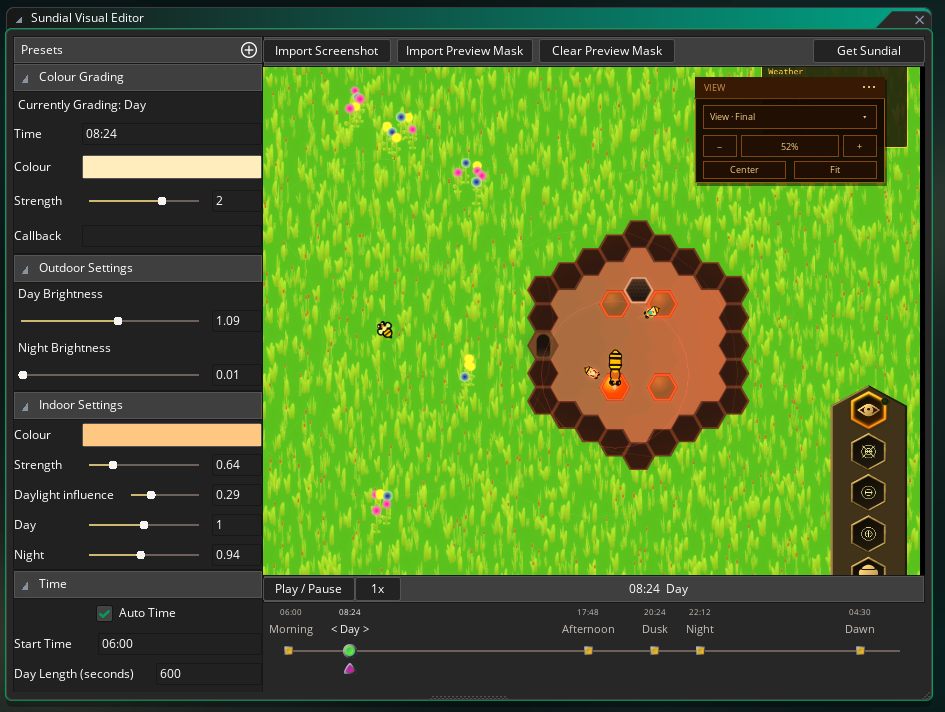
*Bee Sim day hive*

The View palette that sits in the preview window gives you the option to inspect the **Final**, **Original**, **Outdoor**, **Indoor** or **Mask** result, so you can inspect each part individually to track down any weird spots doing bizarre things. Plus normal viewport things like zooming in, centering, fitting, etc.

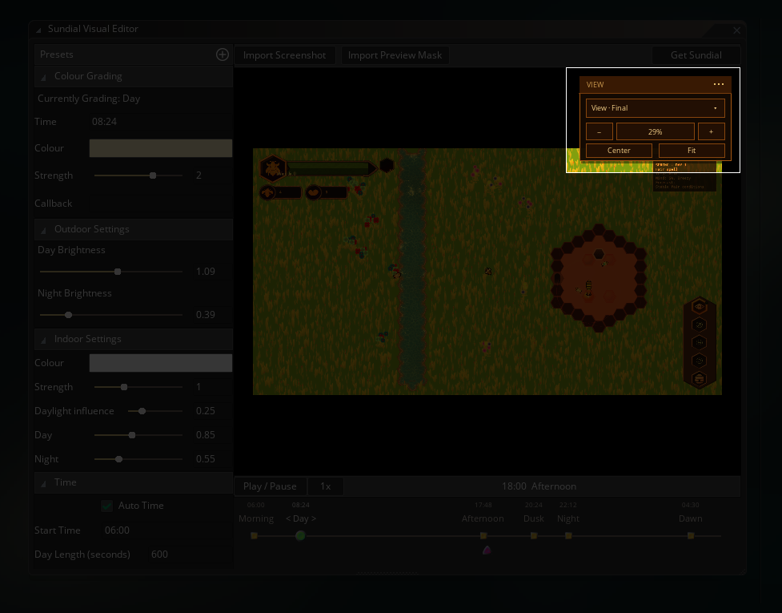
*Sundial View Palette*

> The preview mask is editor-only just like the screenshot of your game. Sundial won't use it during runtime in your game. Instead, you should either dynamically create the mask based on what's on screen (maybe have the inside of houses draw themselves as pure white to a surface you are using as a mask), or if your game is suitable, you can just create a mask sprite in an image editor and give it to Sundial when your game starts.
{: .important}

---

## Callbacks

Each time period has a **Callback** field that allows you to supply a function that will be executed when Sundial hits the particular time of day when the game is running.

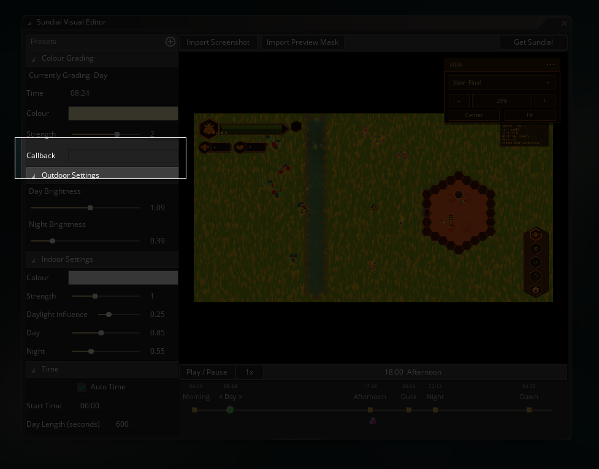
*Sundial Callback Field*

A function reference is perfectly fine (and probably the easiest to work with):

```js
MyDuskFunction
```

> Make sure you **don't** provide the rounded brackets when supplying a function here, as that will *execute* the function, not store it. So `MyDuskFunction()` is incorrect. It should be `MyDuskFunction`.
{: .warning}

But you can also supply a function expression if you wish:

```js
function() { global.streetlights = true; }
```

You don't have to provide anything here if you don't need Sundial to run code for a particular time of day.

You can use this for small things that belong to the schedule you're creating, such as turning street lights on at Dusk. You can still register callbacks from code as well...the Visual Editor callback doesn't replace callbacks that you add via code, instead, all callbacks are added to an array and will all be executed when the time of day is hit.

---

## Starting Sundial in your game

The Visual Editor can handle almost the entirety of Sundial for you. All you need to do in-game is run:

```js
SundialStart();
```

And Sundial will start running the default preset, handling the timing and the drawing of the time periods you set up.

If you want to use a different preset, supply its name as a string to the start function:

```js
SundialStart("my_preset");
```

And finally, when you want Sundial to stop working (maybe you are going back to the main menu or something), simply turn it off with:

```js
SundialStop();
```

---

## Wait that's it?

Indeed, if you're good with having Sundial automatically handle things, then that's the complete setup for most games. `SundialStart()` loads the default preset you made, Sundial automatically handles the timekeeping, and `SundialStop()` turns Sundial off.

There are a few different circumstances in which you might not want the Sundial automatically handling everything for you.

1. An indoor/outdoor mask.
  - You need to provide this through code, but it's still a fairly simple procedure. Learn more about that in the Indoor/Outdoor page.
2. You want to draw with a surface that isn't the application surface.
  - Maybe you have an existing lighting or HDR setup that is taking control of drawing and drawing stuff to a custom surface. Whatever it may be, if your drawing is not being drawn to the application surface, then you'll need to handle Sundial's drawing manually. Again, this isn't complicated, just a tiny bit more code to tell Sundial what surface you want it to handle.
3. You have an existing time source
  - Maybe you already have an existing time source that is handling the flow of time in your game. In that case, you'll want to tell Sundial when to update and you don't want it automatically trying to manage time for you.

This isn't an exhaustive list of times you might want to manually handle some things, but hopefully it gives you an idea of when and how to turn off autopilot and land the ship yourself.

---

## The editor internals

Sundial keeps its files stored in the `/rtg/sundial/` folder in your project folder. This means your presets, the Visual Editor state and its preview images.

You should save your project before uninstalling the Sundial Visual Editor. As long as you've done so, then your presets will remain intact so your game can still use them, and reinstalling the Visual Editor should pick them back up again.

Uninstalling the plugin through the package manager will **not** delete Sundial from your project entirely, only the Visual Editor itself. If you want to remove the code-side of Sundial, delete the `RefresherTowelGames/Sundial` folder from the GM asset browser.

If you are happy losing your presets and stuff like that, and just want to get rid of Sundial entirely, then you'll also likely want to delete the `/rtg/sundial/` folder from your GM project, on top of uninstalling the Visual Editor project and deleting Sundial from your asset browser. This is irreversible (if you are not using source control, *which you should be!*). If you install the Visual Editor again, it will recreate the folder but with the default settings again.

---

## Next: How to set up Sundial in code

Once the preset looks right, you're golden. If you're not interested in using an indoor mask, then you can stop here! Sundial should start working fine with your game at this point.

Continue with **[Using Sundial in your game](using-sundial)** to see how Sundial works in terms of code.
