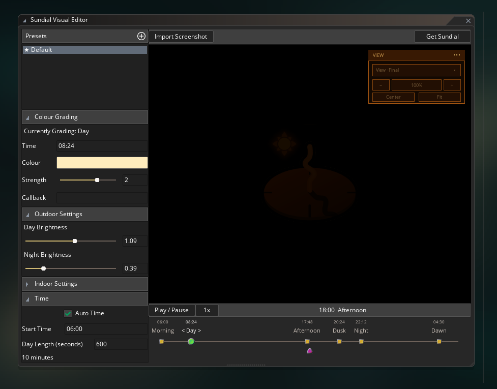

<div class="sticky-toc" markdown="block">
<details open markdown="block">
  <summary>On this page</summary>
  {: .text-delta }

1. TOC
{:toc}

</details>
</div>


{: .text-center}

*Your game, mood-ified!*
{: .text-center}

It's all too easy to chuck a semi-transparent black overlay over your game when night falls and call it a day (or perhaps call it a night, lol). But is that *really* what you want your players to see?

What if you could adjust the actual **mood** of your game over the course of a day. A cold, crisp morning flows gently into a bright sunny midday, followed by an orange, warm afternoon, and a spectacular sunset, of course. Then a night with deep, rich purples.

Well **Sundial** is designed to give you exactly that. And best of all, you can **visually author it inside GM itself**.


*The Sundial Visual Editor*

>The Sundial Visual Editor is **completely free** to try out! Simply visit <a href="https://plugins.refreshertowel.games/" target="_blank" rel="noopener noreferrer">RefresherTowel Games Plugin Access</a> for instructions on how to download and install it, then start trying it out with your game!
{: .important}

Sundial takes an existing 2D scene and grades it continuously through six authored parts of the day:

- **Morning**
- **Day**
- **Afternoon**
- **Dusk**
- **Night**
- **Dawn**

You choose the colour and strength of those looks, Sundial blends between them, and separate day/night brightness controls handle how light the scene should actually be. So you can give your game a stylistic mood easily.

The easiest way to author Sundial is through its GameMaker IDE plugin. Import a screenshot from your game, scrub through the day, drag the period timings around, and tune the result while looking at the actual scene you're trying to grade.

Once you've authored a look, using it in-game is as simple as calling:

```js
SundialStart();
```

and then when you want Sundial to stop handling the day/night cycle, it's simply:

```js
SundialStop();
```

That's the entire code you need to get Sundial up and running, beautifying your day and night cycle!

> Of course, Sundial can also be used as a pure code library, and you can take control of the creation of Sundial constructors, set or change any settings, and also manage the drawing and updating if you wish to. The above code is simply the quickest and easiest way to get Sundial running in an automated way.
{: .note}

<center><iframe frameborder="0" src="https://itch.io/embed/5130558?bg_color=8d4800&amp;fg_color=ffffff&amp;link_color=faa85b&amp;border_color=ffffff" width="552" height="167"><a href="https://refreshertowel.itch.io/sundial">Sundial - Day/Night Cycle &amp; Moods by RefresherTowel</a></iframe></center>

---

## Indoor and outdoor areas can react differently

Sundial also lets you alter how indoor and outdoor areas are graded, by letting you provide an "indoor mask".

On the mask (which should be the same size as your rendering surface), anything drawn as white is considered indoors, anything drawn as black is considered outdoors, and anything greyscale is considered "inbetween" (meaning you can greyscale towards black away from your windows, for a "light spill" during night).

Indoor pixels have their own base colour, grading strength and day/night brightness. They can also inherit some of the outdoor colour through **Indoor Daylight Influence**, which lets a room stay recognisably indoors while still picking up some of the warmth of dusk or the coolness of night.

---

## You don't need the Visual Editor to use Sundial

While the Visual Editor plugin makes it incredibly easy to create the exact moods you want, Sundial also has code equivalents for every change you can make in the plugin. So you can build Sundial entirely in code (if that's your weird little preference):

```js
sundial = new Sundial()
    .SetGrading(eSundial.MORNING, make_color_rgb(194, 242, 229))
    .SetGradingStrength(eSundial.MORNING, 2)
    .SetBrightness(1.09, 0.39)
    .SetTime(6);
```

Every setting the importer applies goes through the same public `Sundial` API available to your own code. The editor is simply a visual authoring layer over that runtime.

That also means disabling or uninstalling the IDE plugin won't suddenly break your projects using Sundial. The GML runtime and the compiled preset data live in the project itself.

---

## In-Game Control

Sundial also gives you plenty of procedural control while your game is running. You can set times directly, skip ahead, reverse time, and so on.

You can check the amount of sunlight there currently is (independently of what the actual phase of day or colour grading is), you can set explicit callbacks that run when each milestone is reached during the day (i.e. have a function that turns all streetlights on when Dusk arrives, etc).

And you can also set all the same grading/brightness/etc controls through code as you can through the Visual Editor plugin.

---

## Where to go next

Start with **[Using the Visual Editor Plugin](ide-plugin)**. That's the magic sauce of Sundial and the quickest way to get Sundial tuned to perfection for your game.

Then move to **[Using Sundial](using-sundial)** for importing presets and drawing them in-game. **[Time, Periods & Callbacks](time-periods-and-callbacks)** covers the clock, automatic time progression and gameplay reactions to Morning, Dusk, Night and the other authored periods.

If your game needs interiors, **[Indoor & Outdoor Grading](indoor-and-outdoor)** explains the mask and the separate indoor controls.

Finally, **[Configuring Sundial in Code](manual-configuration)** covers the full code-only setup for projects that don't want to use the Visual Editor plugin at all.


